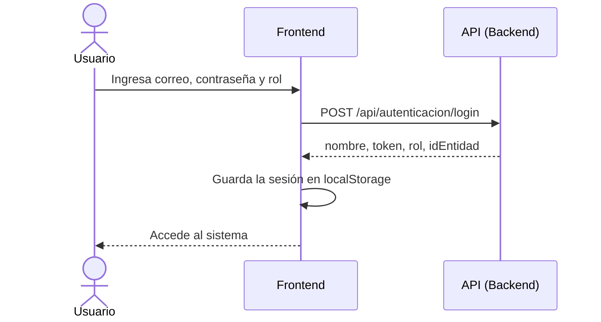

<div align="center">

# 🖥️ Frontend

### Interfaz web del Sistema de Monitoreo de Hemoglobina


[⬅️ Volver al README principal](../README.md)

</div>

---

## 🎯 Descripción

Contiene las páginas que ven los usuarios del sistema: inicio de sesión, registro y monitoreo. Está construido con **HTML, CSS y JavaScript** y usa **Bootstrap 5** para un diseño limpio y adaptable.

## 📄 Pantallas

| Archivo | Descripción |
|---|---|
| 🔑 `index.html` | Inicio de sesión y acceso al registro |
| 📝 `Registro.html` | Registro de pacientes |
| 📈 `Monitoreo.html` | Monitoreo de niveles de hemoglobina |

## ✨ Funcionalidades

- 🔐 Formulario de inicio de sesión con **correo**, **contraseña** y **rol**.
- 🔗 Enlace directo a la pantalla de registro de pacientes.
- 📡 Envío de una solicitud HTTP al backend para autenticar al usuario.
- 💾 Guardado de los datos de sesión en `localStorage` tras un inicio de sesión exitoso.

## 🔄 Flujo de autenticación



## 🚀 Ejecución

1. Clona el repositorio:
   ```bash
   git clone https://github.com/Sunnyri11/Sistema-Web-Hemoglobina.git
   ```
2. Abre `index.html` en el navegador, o usa un servidor local (por ejemplo, *Live Server* en VS Code).
3. Inicia el [backend](../backend/), que el frontend necesita para el inicio de sesión.
4. Verifica que la URL de la API sea correcta para tu entorno.

## ⚙️ Configuración de la API

El código actual usa:

```text
https://localhost:7176/api/autenticacion/login
```

> [!TIP]
> Si tu backend usa otro puerto, dominio o protocolo, cambia esa dirección en el JavaScript de `index.html`.

## 🔐 Notas de seguridad

- 🚫 No incluyas credenciales reales en el código.
- 🔒 En despliegues reales usa **HTTPS**.
- ⚠️ `localStorage` es práctico para desarrollo, pero es accesible desde JavaScript. Para producción conviene evaluar alternativas más seguras para guardar el token (por ejemplo, cookies `HttpOnly`).

<div align="center">

---
[⬅️ Volver al README principal](../README.md)

</div>
