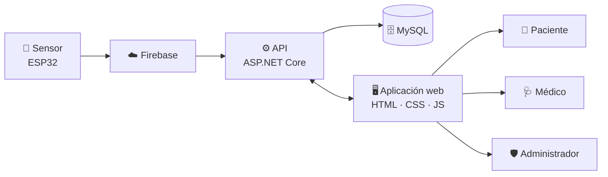

<div align="center">


# 🩸 Sistema Web de Monitoreo No Invasivo de Niveles de Hemoglobina

### Alerta temprana de **anemia** y **poliglobulia** sin extraer sangre

<p>
  
  
  
</p>

<p>
  
  
  
  
  
  
  
  
</p>

[📖 Frontend](frontend/) · [⚙️ Backend](backend/) · [🗄️ Base de datos](base-datos/) · [📡 IoT](iot/) · [📚 Manuales](manuales/)

</div>

---

> [!IMPORTANT]
> Este proyecto es una **herramienta informática de carácter académico**. Sus resultados **no constituyen un diagnóstico médico** y no deben usarse para tomar decisiones clínicas sin validación del dispositivo y evaluación de un profesional de la salud.

## 📑 Tabla de contenidos

- [🎯 Sobre el proyecto](#-sobre-el-proyecto)
- [✨ Características](#-características)
- [🏗️ Arquitectura](#️-arquitectura)
- [🧰 Tecnologías](#-tecnologías)
- [📂 Estructura del repositorio](#-estructura-del-repositorio)
- [🚀 Inicio rápido](#-inicio-rápido)
- [⚙️ Configuración](#️-configuración)
- [🔐 Seguridad y datos](#-seguridad-y-datos)
- [🗺️ Estado y hoja de ruta](#️-estado-y-hoja-de-ruta)
- [👥 Equipo](#-equipo)

## 🎯 Sobre el proyecto

La **anemia** (hemoglobina baja) y la **poliglobulia** (hemoglobina elevada) suelen detectarse tarde porque requieren análisis de sangre. Este sistema propone un **monitoreo no invasivo**: un sensor toma lecturas, los datos viajan a la nube y una aplicación web los muestra a pacientes y médicos para facilitar la **alerta temprana**.

Proyecto desarrollado para la materia **Proyecto de Sistemas I** de la **Universidad Privada del Valle (Univalle)**, aplicando la metodología ágil **Extreme Programming (XP)**.

## ✨ Características

| | Función |
|---|---|
| 🔑 | Inicio de sesión con **correo, contraseña y rol** |
| 📝 | Registro de pacientes |
| 📈 | Pantalla de monitoreo de niveles de hemoglobina |
| 👥 | Tres roles: **paciente**, **médico** y **administrador** |
| 📡 | Captura de datos mediante un sensor basado en **ESP32** |
| ☁️ | Transmisión de lecturas a través de **Firebase** |

## 🏗️ Arquitectura



## 🧰 Tecnologías

| Capa | Tecnología |
|---|---|
| **Frontend** | HTML5, CSS3, JavaScript, Bootstrap 5 |
| **Backend** | ASP.NET Core (API HTTP) |
| **Base de datos** | MySQL |
| **IoT** | ESP32 + Firebase |
| **Gestión** | Metodología XP · Jira |

## 📂 Estructura del repositorio

Cada módulo vive en su propia carpeta o rama y cuenta con su propio README:

```text
Sistema-Web-Hemoglobina/
├── 📄 index.html          → Inicio de sesión
├── 📄 Registro.html       → Registro de pacientes
├── 📄 Monitoreo.html      → Monitoreo de hemoglobina
├── 📁 SistemaHB/          → Carpeta adicional del proyecto
├── 🗜️ SistemaHB.rar       → Archivo comprimido del proyecto
│
├── 🖥️ frontend/           → Interfaz web
├── ⚙️ backend/            → API
├── 🗄️ base-datos/         → Scripts y modelo de datos
├── 📡 iot/                → Sensor y firmware
└── 📚 manuales/           → Manuales de instalación, usuario y técnico
```

## 🚀 Inicio rápido

```bash
# 1. Clonar el repositorio
git clone https://github.com/Sunnyri11/Sistema-Web-Hemoglobina.git
cd Sistema-Web-Hemoglobina
```

1. **Frontend:** abre `index.html` en el navegador o sírvelo con un servidor local (por ejemplo, la extensión *Live Server* de VS Code).
2. **Backend:** inicia la API (ver [backend/](backend/)).
3. **Base de datos:** crea la base de datos con los scripts de [base-datos/](base-datos/).
4. **Probar:** inicia sesión desde `index.html` con datos de prueba.

## ⚙️ Configuración

El frontend consulta por defecto la API local:

```text
https://localhost:7176
```

> [!NOTE]
> Esa dirección solo funciona en tu equipo. Si el backend corre en otro puerto, dominio o protocolo, actualiza la URL de la API en el JavaScript del frontend.

## 🔐 Seguridad y datos

- 🚫 No publiques contraseñas, claves privadas, tokens reales ni cadenas de conexión con credenciales.
- 🧪 Usa **datos de prueba** y configuración local durante el desarrollo.
- 🔒 Usa **HTTPS** en cualquier entorno desplegado.

## 🗺️ Estado y hoja de ruta

Proyecto **en desarrollo** bajo XP: 5 iteraciones de 2 semanas, 10 historias de usuario del backlog (PB-01 a PB-10) y seguimiento en Jira.

- [x] Épicas 1 y 2
- [ ] Épica 3 *(en curso)*
- [ ] Épicas 4 y 5

## 👥 Equipo

| Rol | Integrante |
|---|---|
| 👨‍🏫 Docente | Ing. Georgina Aruquipa Gutierrez |
| 👩‍💻👨‍💻 Desarrolladores |-Jhoel Flores -Wilder Chura -Fabricio Pinaya -Axel Canqui|

<div align="center">

---

Hecho con ❤️ en Bolivia 🇧🇴 · **Univalle** · Proyecto de Sistemas I

</div>
