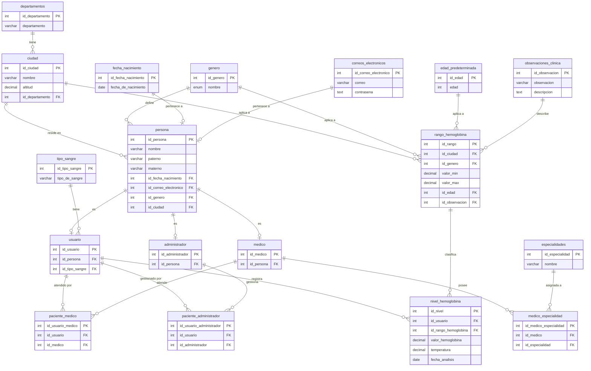

<div align="center">

# 🗄️ Base de datos

### Modelo relacional del Sistema Web de Monitoreo de Hemoglobina


[⬅️ Volver al README principal](../README.md)

</div>

---

## 📑 Contenido

- [🎯 Descripción](#-descripción)
- [🗺️ Diagrama entidad-relación](#️-diagrama-entidad-relación)
- [📋 Diccionario de datos](#-diccionario-de-datos)
- [🧠 Cómo funciona el modelo](#-cómo-funciona-el-modelo)
- [🚀 Instalación](#-instalación)
- [🔐 Seguridad](#-seguridad)

## 🎯 Descripción

La base de datos almacena a las **personas** del sistema y sus tres roles (**paciente/usuario**, **médico** y **administrador**), junto con las **mediciones de hemoglobina** y los **rangos de referencia** con los que se interpretan. Está normalizada: ciudades, géneros, fechas de nacimiento, correos y tipos de sangre viven en tablas propias.

## 🗺️ Diagrama entidad-relación



## 📋 Diccionario de datos

### 👤 Personas y roles

| Tabla | Campos | Descripción |
|---|---|---|
| 🧑 **persona** | `id_persona` PK · `nombre` · `paterno` · `materno` · `id_fecha_nacimiento` FK · `id_correo_electronico` FK · `id_genero` FK · `id_ciudad` FK | Datos personales comunes a todos los roles |
| 🤒 **usuario** | `id_usuario` PK · `id_persona` FK · `id_tipo_sangre` FK | Rol de **paciente** |
| 🩺 **medico** | `id_medico` PK · `id_persona` FK | Rol de **médico** |
| 🛡️ **administrador** | `id_administrador` PK · `id_persona` FK | Rol de **administrador** |

### 🔗 Relaciones entre roles

| Tabla | Campos | Descripción |
|---|---|---|
| 🤝 **paciente_medico** | `id_usuario_medico` PK · `id_usuario` FK · `id_medico` FK | Qué médico atiende a cada paciente |
| 🤝 **paciente_administrador** | `id_usuario_administrador` PK · `id_usuario` FK · `id_administrador` FK | Qué administrador gestiona a cada paciente |
| 🎓 **medico_especialidad** | `id_medico_especialidad` PK · `id_medico` FK · `id_especialidad` FK | Especialidades de cada médico (N:M) |

### 📇 Catálogos

| Tabla | Campos | Descripción |
|---|---|---|
| 🎓 **especialidades** | `id_especialidad` PK · `nombre` VARCHAR(200) | Especialidades médicas |
| 🏙️ **ciudad** | `id_ciudad` PK · `nombre` VARCHAR(100) · `altitud` DECIMAL(10,2) · `id_departamento` FK | Ciudades con su altitud |
| 🗺️ **departamentos** | `id_departamento` PK · `departamento` VARCHAR(200) | Departamentos |
| ⚧️ **genero** | `id_genero` PK · `nombre` ENUM | Géneros |
| 🎂 **fecha_nacimiento** | `id_fecha_nacimiento` PK · `fecha_de_nacimiento` DATE | Fechas de nacimiento |
| 📧 **correos_electronicos** | `id_correo_electronico` PK · `correo` VARCHAR(250) · `contraseña` TEXT | Credenciales de acceso |
| 🩸 **tipo_sangre** | `id_tipo_sangre` PK · `tipo_de_sangre` VARCHAR(100) | Grupos sanguíneos |
| 📅 **edad_predeterminada** | `id_edad` PK · `edad` INTEGER | Edades de referencia para los rangos |

### 🔬 Hemoglobina

| Tabla | Campos | Descripción |
|---|---|---|
| 📏 **rango_hemoglobina** | `id_rango` PK · `id_ciudad` FK · `id_genero` FK · `valor_min` DECIMAL(4,2) · `valor_max` DECIMAL(4,2) · `id_edad` FK · `id_observacion` FK | Rango normal según ciudad, género y edad |
| 📝 **observaciones_clinica** | `id_observacion` PK · `observacion` VARCHAR(150) · `descripcion` TEXT | Interpretación clínica asociada a un rango |
| 📈 **nivel_hemoglobina** | `id_nivel` PK · `id_usuario` FK · `id_rango_hemoglobina` FK · `valor_hemoglobina` DECIMAL(4,2) · `temperatura` DECIMAL(5,2) · `fecha_analisis` DATE | Cada medición de un paciente |

## 🧠 Cómo funciona el modelo

1. Toda persona se registra en **`persona`**, con su ciudad, género, fecha de nacimiento y correo.
2. Según su rol, se crea un registro en **`usuario`** (paciente), **`medico`** o **`administrador`**.
3. Cada medición se guarda en **`nivel_hemoglobina`** y se enlaza a un **`rango_hemoglobina`**.
4. El rango depende de **ciudad** (por la altitud), **género** y **edad**, y trae una **observación clínica** que ayuda a detectar anemia o poliglobulia.

> [!TIP]
> Incluir la **altitud** de la ciudad es clave: a mayor altura, los valores normales de hemoglobina son más altos.

## 🚀 Instalación

1. Instala **MySQL** y un gestor (MySQL Workbench, DBeaver o similar).
2. Ejecuta el script de creación:
   ```bash
   mysql -u <usuario> -p < schema.sql
   ```
3. Configura el [backend](../backend/) con tu cadena de conexión **local**.

El script [`schema.sql`](schema.sql) crea las 18 tablas en el orden correcto de dependencias.

## 🔐 Seguridad

> [!WARNING]
> La columna `contraseña` es de tipo `TEXT`. **Nunca guardes contraseñas en texto plano**: almacena solo un *hash* con sal (por ejemplo, BCrypt o PBKDF2 en ASP.NET Core).

- 🚫 No publiques cadenas de conexión con credenciales.
- 🔧 Usa variables de entorno o un archivo local excluido con `.gitignore`.
- 🧪 Usa datos de prueba; los datos de salud reales son sensibles.

<div align="center">

---
[⬅️ Volver al README principal](../README.md)

</div>
