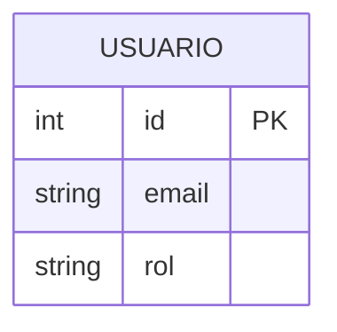

# 🗄️ Base de datos

### Almacenamiento de datos del Sistema de Monitoreo de Hemoglobina

[⬅️ Volver al README principal](../README.md)

---

## 🎯 Descripción

Esta sección documenta la estructura de datos del sistema y los scripts para crearla. El sistema usa **MySQL** como motor de base de datos, consumido por la API en ASP.NET Core.

## 📦 Contenido

| | Elemento | Estado |
|---|---|---|
| 📜 | Script de creación de la base de datos | ⏳ Por documentar |
| 📋 | Tablas y descripción de sus campos | ⏳ Por documentar |
| 🔑 | Claves primarias y foráneas | ⏳ Por documentar |
| 🔗 | Relaciones entre entidades | ⏳ Por documentar |
| 🧪 | Datos de prueba | ⏳ Por documentar |
| 💾 | Respaldo y restauración | ⏳ Por documentar |

## 🚀 Instalación

1. Instala **MySQL** y un gestor (MySQL Workbench, DBeaver o similar).
2. Crea una conexión local.
3. Ejecuta los scripts de creación en el orden indicado.
4. Carga los datos de prueba, si el proyecto los incluye.
5. Configura el [backend](../backend/) con tu cadena de conexión local.

## 🗺️ Modelo de datos

Aquí irá el diagrama entidad-relación. Puedes escribirlo en Mermaid y GitHub lo mostrará automáticamente:

## 🔐 Configuración segura

- 🚫 No publiques contraseñas ni cadenas de conexión con credenciales.
- 🔧 Usa variables de entorno o un archivo local excluido con `.gitignore`.

---
[⬅️ Volver al README principal](../README.md)

